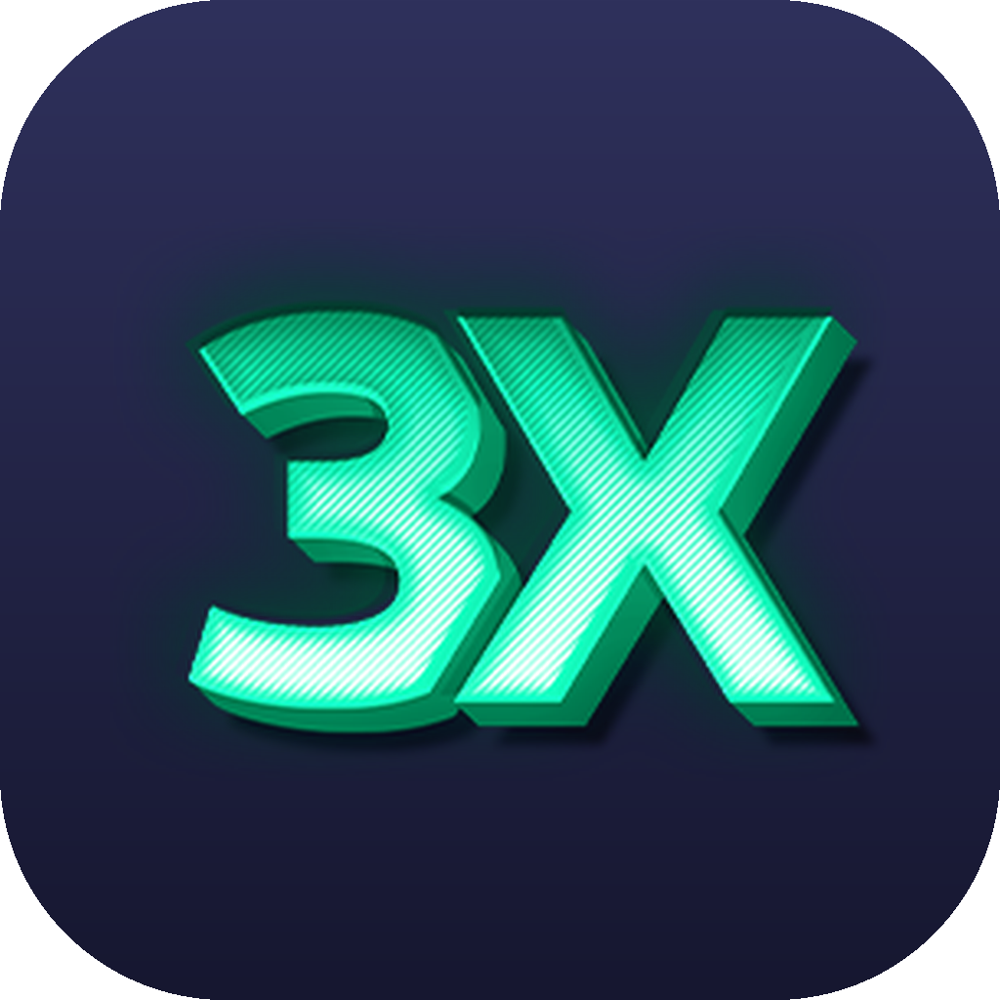
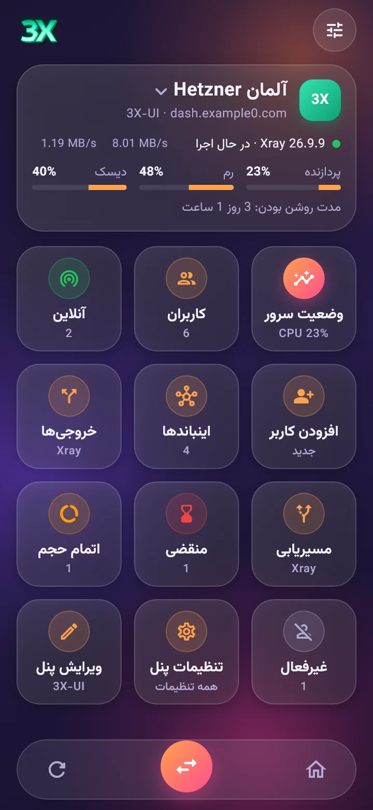
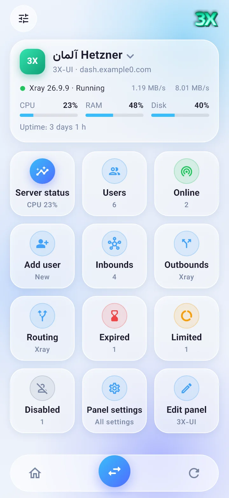
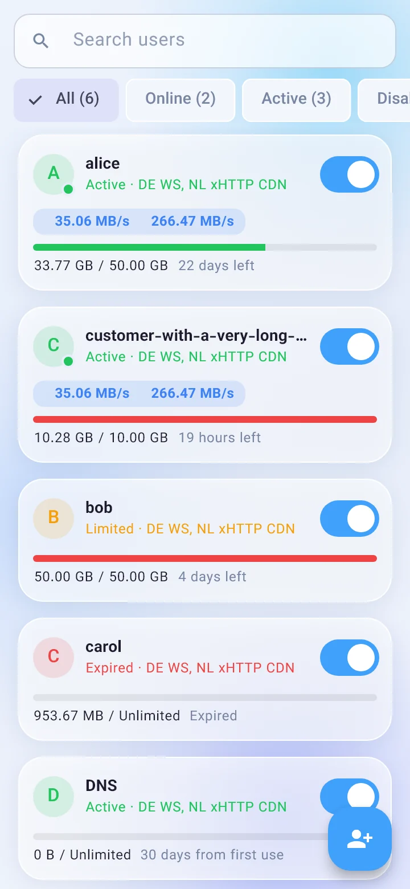

<p align="center">
  
</p>

<h1 align="center">XUI Manager</h1>

<p align="center"><a href="https://hits.sh/github.com/Plus98ir/XUI-Manager/"></a> <a href="https://corenetbase.com/#support"></a></p>

<details>
<summary><b>☕ Support · حمایت</b> — USDT (TRC20) / TRX</summary>
<br>
<p align="center"></p>

```
TA53aFyGNfSAcrCaJi9QmA9x5W47nPJcf7
```

> [!WARNING]
> **TRON network only.** Sending from ERC20 / BEP20 will lose the funds.<br>
> **فقط شبکه‌ی TRON.** ارسال از ERC20 یا BEP20 پول را از بین می‌برد.

</details>

<p align="center">
  Manage <b>3X-UI</b>, <b>Alireza X-UI</b> and <b>Marzban</b> panels from your Android phone.<br>
  مدیریت پنل‌های <b>3X-UI</b>، <b>علیرضا X-UI</b> و <b>مرزبان</b> از روی گوشی اندروید.
</p>

<p align="center">
  <a href="https://github.com/Plus98ir/XUI-Manager/releases/latest"><b>⬇️ Download APK / دانلود</b></a> ·
  <a href="https://plus98ir.github.io/XUI-Manager/"><b>🌐 Website / سایت</b></a>
</p>

<p align="center">
  
  
  
</p>

<div align="center">

[ &nbsp;**English**](README.md) &nbsp;&nbsp;|&nbsp;&nbsp; [ &nbsp;**فارسی**](README.fa.md)

</div>

<div dir="rtl">

یک برنامه اندروید که مستقیم با API پنل شما کار می‌کند و چیزی روی سرور نصب نمی‌کند: برنامه را نصب کنید، آدرس پنل را وارد کنید و وارد شوید. اگر صفحه خود پنل را ترجیح می‌دهید، هر پنل به‌صورت پنل وب هم داخل برنامه باز می‌شود؛ مثل PWA پنل، ولی همه سرورها در یک برنامه.

### امکانات
- **پنل‌ها:** 3X-UI (همراه با توکن API نسخه 3.x)، علیرضا X-UI و مرزبان. تا ۲۰ پنل، با جابه‌جایی سریع بین آن‌ها.
- **پنل وب:** صفحه وب خود پنل داخل برنامه باز می‌شود و ورود خودکار انجام می‌شود. مثل PWA پنل است، با این فرق که همه سرورهایتان در یک برنامه‌اند. برای هر پنل انتخاب کنید با زدن روی آن صفحه‌های برنامه باز شود یا پنل وب.
- **وضعیت سرور:** نمودار زنده CPU، رم، Swap، دیسک، سرعت شبکه و اتصال‌های باز، به‌همراه مدت روشن بودن و آمار پنل. ری‌استارت Xray یا پنل.
- **کاربران:** جستجو و فیلتر (آنلاین، فعال، غیرفعال، منقضی، اتمام حجم)، افزودن، ویرایش، حذف، فعال/غیرفعال کردن و ریست ترافیک. سرعت زنده هر کاربر. QR کد، لینک اشتراک و لینک کانفیگ. در 3X-UI 3.x هر کاربر می‌تواند به چند اینباند (از جمله Hysteria و AmneziaWG) وصل شود، گروه از لیست انتخاب می‌شود، و می‌توان یک گروه کامل یا کاربران دلخواه را به یک اینباند اضافه کرد.
- **اینباندها:** همه پروتکل‌های پنل: VLESS، VMess، Trojan، Shadowsocks، Hysteria2، TUIC، WireGuard، AmneziaWG، MTProto، Mixed (SOCKS + HTTP)، HTTP، Tunnel و TUN، با TCP، WS، gRPC، xHTTP، TLS و Reality (همراه با ساخت کلید). سرعت زنده هر اینباند.
- **خروجی‌ها (Outbound):** افزودن از روی لینک کانفیگ (`vless://`، `vmess://`، `trojan://`، `ss://`) یا انتخاب مستقیم، مسدود، WARP، SOCKS و HTTP. ویرایش، جابه‌جایی و تعیین خروجی پیش‌فرض.
- **مسیریابی (Routing):** استراتژی دامنه، جابه‌جایی قانون‌ها با کشیدن، و فرم قانون برای دامنه، آی‌پی، پورت، شبکه، پروتکل و تگ اینباند.
- **تنظیمات پنل:** همه تنظیمات پنل، دسته‌بندی‌شده و قابل جستجو، به‌علاوه ویرایشگر کانفیگ Xray.
- **ظاهر:** دو استایل شیشه‌ای (شفق و یخی)، هرکدام با حالت روشن و تیره. رابط کامل فارسی و انگلیسی با پشتیبانی راست‌به‌چپ.

### نصب
1. از بخش [Releases](https://github.com/Plus98ir/XUI-Manager/releases/latest) یکی از فایل‌ها را دانلود کنید:
   - `xui-manager-arm64-v8a-release.apk`: برای بیشتر گوشی‌های چند سال اخیر.
   - `xui-manager-universal.apk`: روی همه گوشی‌ها کار می‌کند (حجم بیشتر).
2. فایل را روی گوشی باز کنید و اجازه نصب از این منبع را بدهید.
3. اگر Google Play Protect هشدار داد، روی **More details** و بعد **Install anyway** بزنید. برنامه متن‌باز است و GitHub Actions آن را از همین مخزن می‌سازد.

نسخه‌های جدید روی نسخه قبلی نصب می‌شوند و پنل‌های شما حفظ می‌شوند.

### افزودن پنل
- **3X-UI / علیرضا X-UI:** آدرس کامل پنل همراه با مسیر مخفی (مثلاً `https://panel.example.com:2053/secretpath`)، سپس نام کاربری و رمز. در 3X-UI 3.x می‌توانید به‌جای آن توکن API وارد کنید.
- **مرزبان:** آدرس داشبورد، سپس نام کاربری و رمز ادمین، یا توکن.

### حریم خصوصی
آدرس پنل‌ها و اطلاعات ورود فقط روی گوشی خودتان و در حافظه رمزشده اندروید ذخیره می‌شود. برنامه فقط با پنل‌هایی که خودتان اضافه می‌کنید ارتباط دارد و هیچ آمارگیر یا سرور شخص ثالثی ندارد.

</div>
