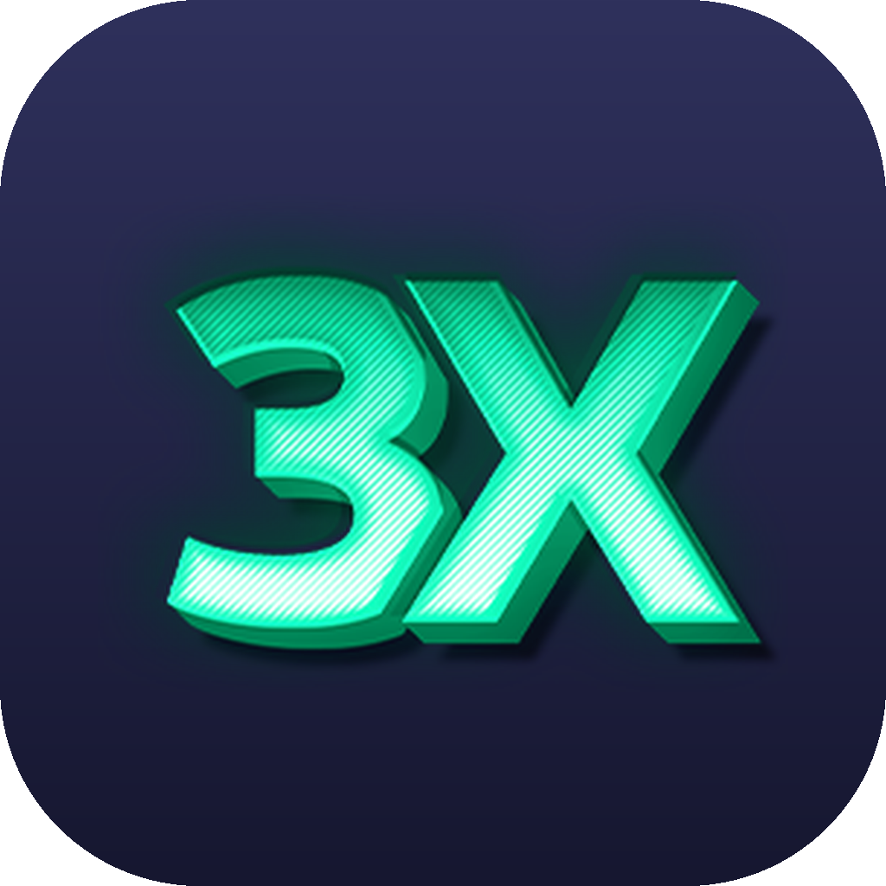
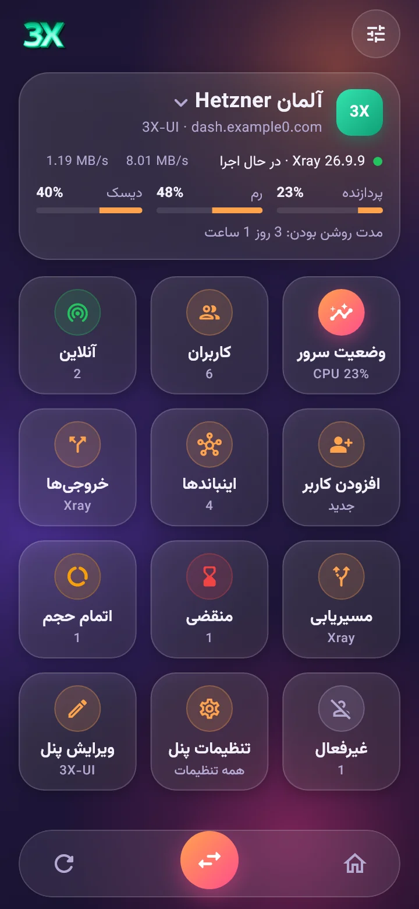
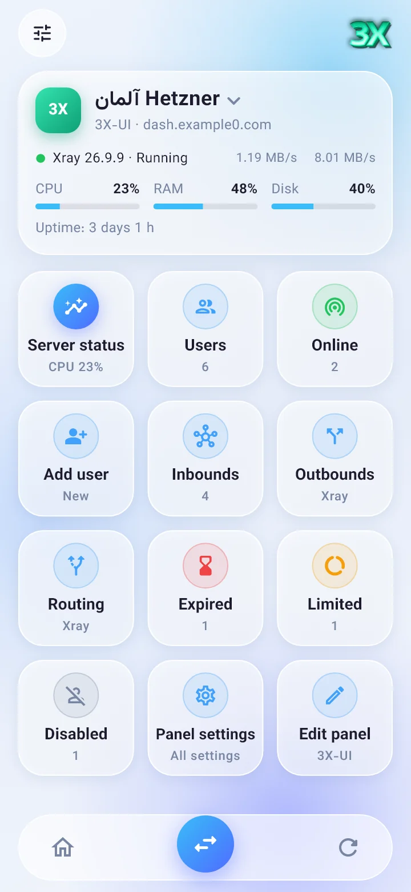
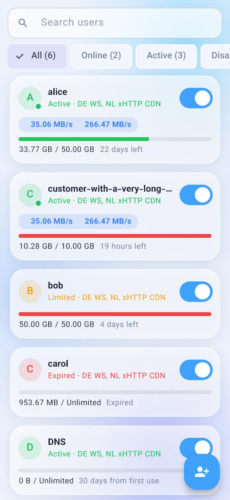
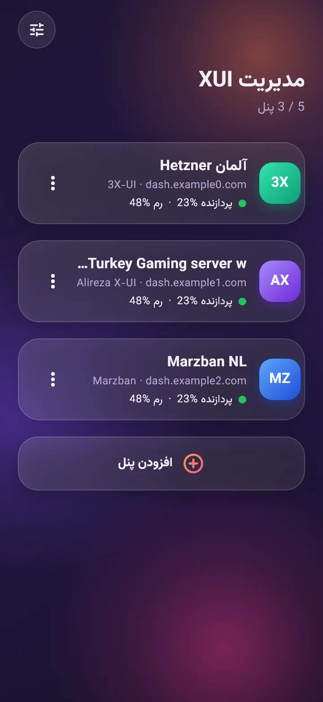
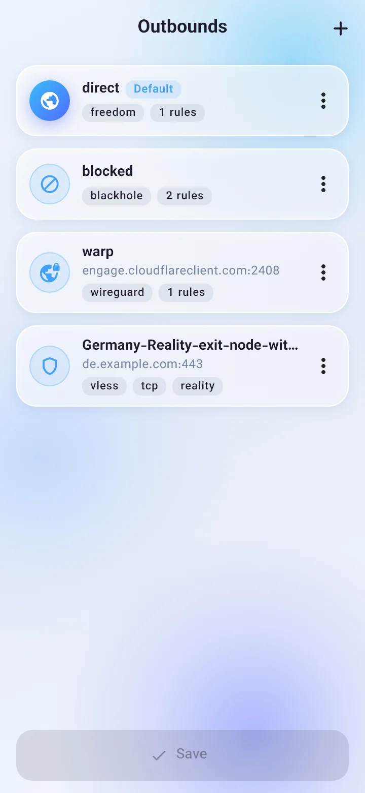
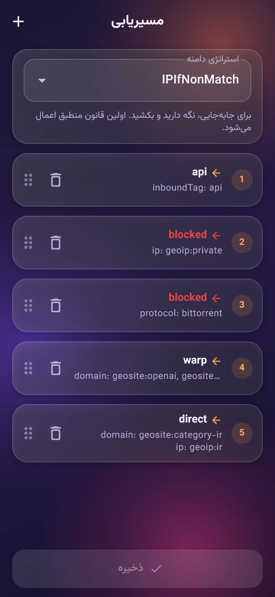
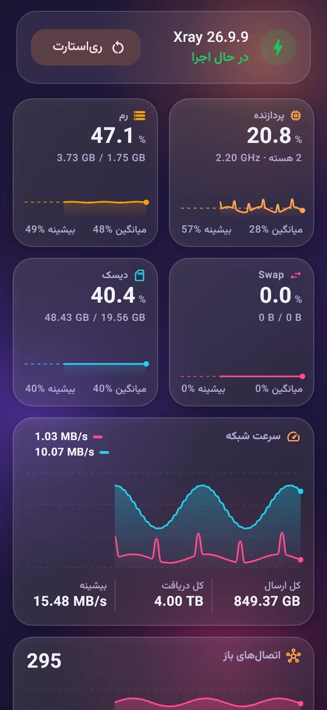
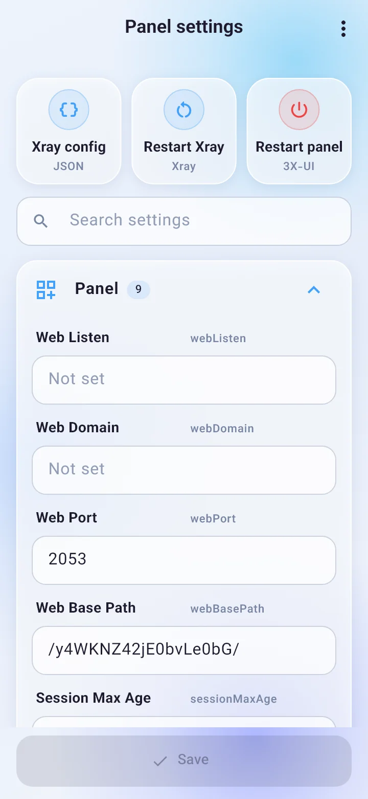
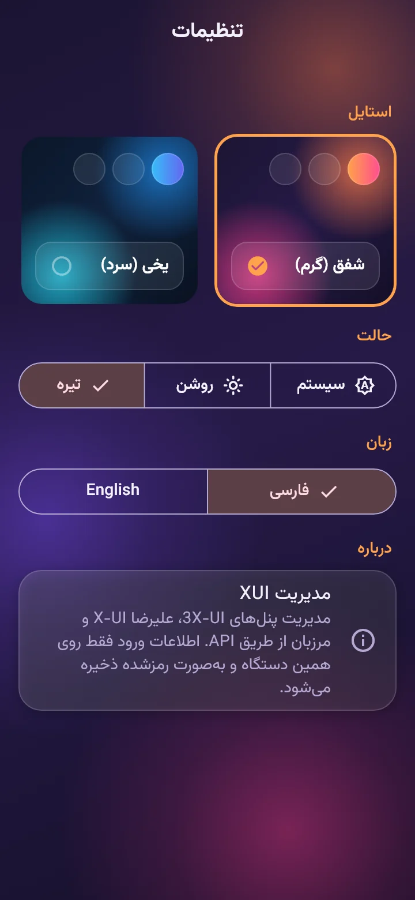

<p align="center">
  
</p>

<h1 align="center">XUI Manager</h1>

<p align="center"><a href="https://hits.sh/github.com/Plus98ir/XUI-Manager/"></a> <a href="https://corenetbase.com/#support"></a></p>

<details>
<summary><b>☕ Support · حمایت</b> — USDT (TRC20) / TRX</summary>
<br>
<p align="center"></p>

```
TA53aFyGNfSAcrCaJi9QmA9x5W47nPJcf7
```

> [!WARNING]
> **TRON network only.** Sending from ERC20 / BEP20 will lose the funds.<br>
> **فقط شبکه‌ی TRON.** ارسال از ERC20 یا BEP20 پول را از بین می‌برد.

</details>

<p align="center">
  Manage <b>3X-UI</b>, <b>Alireza X-UI</b> and <b>Marzban</b> panels from your Android phone.<br>
  مدیریت پنل‌های <b>3X-UI</b>، <b>علیرضا X-UI</b> و <b>مرزبان</b> از روی گوشی اندروید.
</p>

<p align="center">
  <a href="https://github.com/Plus98ir/XUI-Manager/releases/latest"><b>⬇️ Download APK / دانلود</b></a> ·
  <a href="https://plus98ir.github.io/XUI-Manager/"><b>🌐 Website / سایت</b></a>
</p>

<p align="center">
  
  
  
</p>

<div align="center">

[ &nbsp;**English**](README.md) &nbsp;&nbsp;|&nbsp;&nbsp; [ &nbsp;**فارسی**](README.fa.md)

</div>

A native Android app that talks to your panel's API. Nothing to install on the server: install the app, add your panel's address and log in. Want the panel's own page instead? Each panel can also open as a built-in web panel, like the panel's PWA, but with all your servers in one app.

### Features
- **Panels:** 3X-UI (including 3.x API tokens), Alireza X-UI and Marzban. Up to 20 panels, with a one-tap switcher.
- **Web panel:** open any panel's own web page inside the app, signed in automatically. It works like the panel's PWA, except one app holds all your servers. Choose per panel whether a tap opens the app screens or the web panel.
- **Server status:** live charts for CPU, RAM, swap, disk, network speed and open connections, plus uptime and panel stats. Restart Xray or the panel.
- **Users:** search and filter (online, active, disabled, expired, depleted), add, edit, delete, enable/disable and reset traffic. Live per-user speed. QR codes, subscription links and config links. On 3X-UI 3.x one user can sit on several inbounds (including Hysteria and AmneziaWG), groups are picked from a list, and a whole group or chosen users can be attached to an inbound.
- **Inbounds:** every protocol the panel offers: VLESS, VMess, Trojan, Shadowsocks, Hysteria2, TUIC, WireGuard, AmneziaWG, MTProto, Mixed (SOCKS + HTTP), HTTP, Tunnel and TUN, with TCP, WS, gRPC, xHTTP, TLS and Reality (key generation included). Live speed per inbound.
- **Outbounds:** add from a share link (`vless://`, `vmess://`, `trojan://`, `ss://`), or pick Direct, Block, WARP, SOCKS or HTTP. Edit, reorder and set the default.
- **Routing:** domain strategy, drag-to-reorder rules, and a rule form for domains, IPs, ports, network, protocol and inbound tags.
- **Panel settings:** every panel setting, grouped and searchable, plus the raw Xray config editor.
- **Look:** two glass styles (Aurora and Frost), each in light and dark. Full Farsi and English UI with RTL support.

### Screenshots
| Panels | Outbounds | Routing |
|---|---|---|
|  |  |  |
| **Server status** | **Panel settings** | **Styles** |
|  |  |  |

### Install
1. Open [Releases](https://github.com/Plus98ir/XUI-Manager/releases/latest) and download an APK:
   - `xui-manager-arm64-v8a-release.apk`: most phones from the last few years.
   - `xui-manager-universal.apk`: works everywhere (bigger file).
2. Open the file on your phone and allow installing from this source.
3. If Google Play Protect warns about an unknown app, tap **More details → Install anyway**. The app is open source and built by GitHub Actions from this repository.

Updates install over the previous version and keep your panels.

### Adding a panel
- **3X-UI / Alireza X-UI:** the full panel address including the secret path (for example `https://panel.example.com:2053/secretpath`), then username and password. On 3X-UI 3.x you can use an API token instead.
- **Marzban:** the dashboard address, then admin username and password, or a token.

### Privacy
Panel addresses and credentials are stored only on your phone, in Android's encrypted storage. The app talks only to the panels you add; there are no analytics or third-party servers.

### Build from source
The `android/` folder is generated during the build. See [`.github/workflows/build.yml`](.github/workflows/build.yml):
```bash
flutter create --platforms=android --org com.plus98 --project-name xui_manager .
python3 tool/patch_android.py
flutter pub get
dart run flutter_launcher_icons
flutter build apk --release
```
